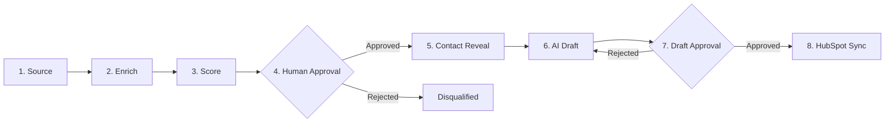

# LeadFlow Platform

> **AI-Powered Multi-Tenant B2B Lead Intelligence, Scoring, and Outreach Orchestration System**

---

## 1. System Overview

LeadFlow is an enterprise-grade lead intelligence platform built for B2B revenue and sales intelligence teams. It autonomously discovers company prospects, enriches deep technical and marketing signals, calculates explainable prospect scores using a 22-signal weighted algorithm, enforces human approval gates, crafts AI-tailored outreach messaging, and idempotently synchronizes with HubSpot CRM.

### Core Value Pillars
- **Strict Multi-Tenant Isolation**: Row-Level Security (RLS) and organization-scoped transaction contexts.
- **Explainable 22-Signal Scoring Engine**: Normalized signal aggregation that gracefully handles missing data without skewing prospect quality.
- **Spend & Action Safety Gates**: Human sign-off required prior to contact reveals, AI generation, and CRM export.
- **Asynchronous Processing Pipeline**: Fast HTTP 202 Accepted response semantics backed by Redis-powered ARQ workers for long-running batch operations.
- **Live Provider Isolation**: Standardized adapter pattern separating third-party APIs (Hunter.io, Google PageSpeed, HubSpot, OpenRouter) with graceful degradation for unconfigured services.

---

## 2. Technology Stack

| Layer | Technologies |
| :--- | :--- |
| **Frontend** | Next.js 16 (App Router), React 19, TypeScript, Tailwind CSS |
| **Backend API** | Python 3.12, FastAPI, Pydantic v2, SQLAlchemy 2.0 (Asyncio) |
| **Database & Migrations**| PostgreSQL 16 with Row-Level Security (RLS), Alembic |
| **Queue & Cache** | Redis 7, ARQ Async Worker |
| **Containerization** | Docker, Docker Compose |
| **Security & Auth** | JWT (HS256), bcrypt password hashing, Role-Based Access Control (RBAC) |
| **External Providers** | Hunter.io, OpenRouter, HubSpot, Google PageSpeed, Google Places, DataForSEO, SerpApi, Firecrawl, Resend |

---

## 3. Monorepo Structure

```text
leadflow/
├── apps/
│   ├── api/                     # FastAPI backend application
│   │   ├── alembic/             # Database migrations
│   │   ├── app/
│   │   │   ├── api/             # REST endpoints (v1 routes)
│   │   │   ├── core/            # Config, logging, constants
│   │   │   ├── db/              # SQLAlchemy session, engine, base
│   │   │   ├── jobs/            # ARQ background task workers
│   │   │   ├── models/          # 14 SQLAlchemy relational models
│   │   │   ├── providers/       # Adapter layer for external APIs
│   │   │   ├── repositories/    # Organization-isolated query layer
│   │   │   ├── schemas/         # Pydantic v2 validation contracts
│   │   │   ├── scoring/         # 22-signal scoring engine implementation
│   │   │   ├── security/        # JWT, bcrypt, RBAC, tenant isolation
│   │   │   ├── services/        # Domain business logic & safety gates
│   │   │   └── main.py          # Application entrypoint & health checks
│   │   ├── tests/               # Backend test suite
│   │   ├── pyproject.toml       # Python dependencies & packaging
│   │   └── Dockerfile           # Backend container definition
│   └── web/                     # Next.js 16 frontend application
│       ├── src/
│       │   ├── app/             # App Router pages (Dashboard, Leads, etc.)
│       │   ├── components/      # UI primitives & domain components
│       │   ├── features/        # Feature state & hooks
│       │   ├── hooks/           # Polling, auth, lead hooks
│       │   ├── lib/             # Typed API client & utilities
│       │   └── types/           # TypeScript schema definitions
│       ├── package.json         # Frontend dependencies & scripts
│       └── Dockerfile           # Web container definition
├── infra/
│   └── docker/
│       ├── docker-compose.yml   # Multi-service local stack
│       └── init-db.sql          # Postgres roles & RLS initialization
├── docs/                        # Architectural & setup documentation
│   ├── architecture.md          # Architectural decisions & job flows
│   ├── database.md              # Complete ERD & RLS policies
│   ├── api.md                   # REST API contract & 202 Polling specs
│   ├── integrations.md          # External provider adapters & fallbacks
│   ├── security.md              # Auth, RBAC matrix, and audit controls
│   └── setup.md                 # Local installation and verification guide
├── .env.example                 # Environment configuration template
├── .gitignore                   # Version control ignore rules
├── Makefile                     # Developer command runner
└── README.md                    # Project landing documentation
```

---

## 4. The 8-Stage Pipeline & Spend Safety



1. **Source Discovery**: Search leads via Hunter.io (Discover POST /discover) or direct domain lists (asynchronous ARQ job returning HTTP 202).
2. **Enrichment**: Collect website crawl meta, Google PageSpeed insights, and external data into a unified JSONB structure.
3. **22-Signal Scoring**: Calculate normalized score (0–100) across Website and Marketing categories. Missing provider data is represented as `None` and skipped without lowering score.
4. **Human Approval Gate**: Operators review scores and evidence before any credits/costs are incurred.
5. **Contact Reveal**: Email and phone numbers remain masked until an operator explicitly triggers reveal.
6. **AI Draft Generation**: OpenRouter crafts tailored outreach proposals citing concrete audit evidence.
7. **Draft Approval Gate**: Outbound copy must be explicitly reviewed and accepted by a human.
8. **CRM Synchronization**: Idempotently upsert contacts and log notes in HubSpot CRM.

---

## 5. Quickstart & Container Management

For comprehensive installation instructions, Windows setup, and full troubleshooting, see [docs/setup.md](docs/setup.md).

### Prerequisites
- Python 3.12+ (Installed: `Python 3.12.6`)
- Node.js 20+ (Installed: `v24.21.0` with npm `11.19.0`)
- Docker Desktop with WSL 2 backend & Docker Compose v2+

### Docker Compose Service Architecture
The local stack in `infra/docker/docker-compose.yml` provides:
- `postgres` (`leadflow_postgres`): PostgreSQL 16 on port `5432` with named volume `postgres_data`
- `redis` (`leadflow_redis`): Redis 7 on port `6379` with named volume `redis_data`
- `api` (`leadflow_api`): FastAPI application on port `8000`
- `worker` (`leadflow_worker`): ARQ background task runner
- `web` (`leadflow_web`): Next.js 16 frontend on port `3000`

### Step-by-Step Local Development

```powershell
# 1. Environment configuration
Copy-Item .env.example .env

# 2. Validate Compose configuration
docker compose -f infra/docker/docker-compose.yml config

# 3. Start PostgreSQL and Redis
docker compose -f infra/docker/docker-compose.yml up -d postgres redis

# 4. Verify database and Redis readiness
docker compose -f infra/docker/docker-compose.yml exec postgres pg_isready -U leadflow_admin -d leadflow
docker compose -f infra/docker/docker-compose.yml exec redis redis-cli ping

# 5. Apply database migrations
cd apps/api
.\.venv\Scripts\alembic.exe upgrade head

# 6. Start FastAPI Development Server
.\.venv\Scripts\uvicorn.exe app.main:app --reload --host 0.0.0.0 --port 8000

# 7. Start ARQ Background Worker (in separate shell)
cd apps/api
.\.venv\Scripts\python.exe -m arq app.jobs.worker.WorkerSettings

# 8. Start Frontend Development Server (in separate shell)
cd apps/web
npm run dev
```

### Essential Container Commands
```powershell
# View container status & health
docker compose -f infra/docker/docker-compose.yml ps

# View live container logs
docker compose -f infra/docker/docker-compose.yml logs -f postgres redis

# Restart a service
docker compose -f infra/docker/docker-compose.yml restart postgres

# Gracefully stop containers without data loss
docker compose -f infra/docker/docker-compose.yml stop
# Or tear down containers while keeping persistent volumes intact:
docker compose -f infra/docker/docker-compose.yml down

# Rebuild container images
docker compose -f infra/docker/docker-compose.yml build
```

> [!CAUTION]
> **DESTRUCTIVE OPERATION**: Never run `docker compose down -v`. The `-v` flag deletes persistent database volumes (`postgres_data`, `redis_data`) and permanently destroys stored tenant data.

